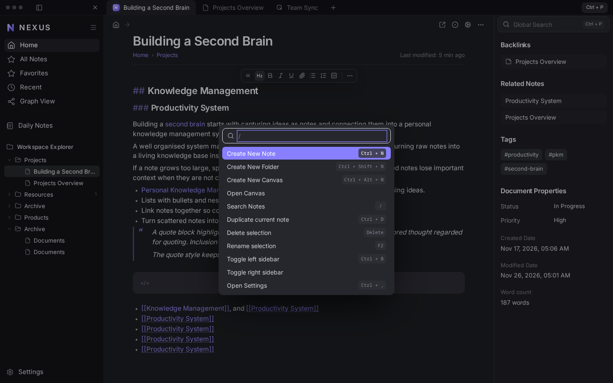
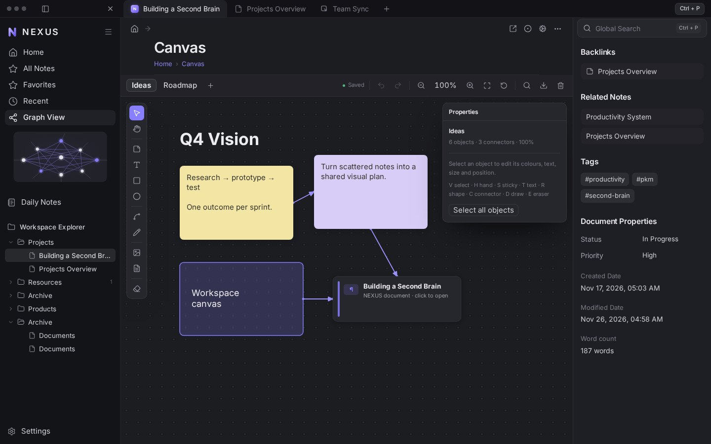
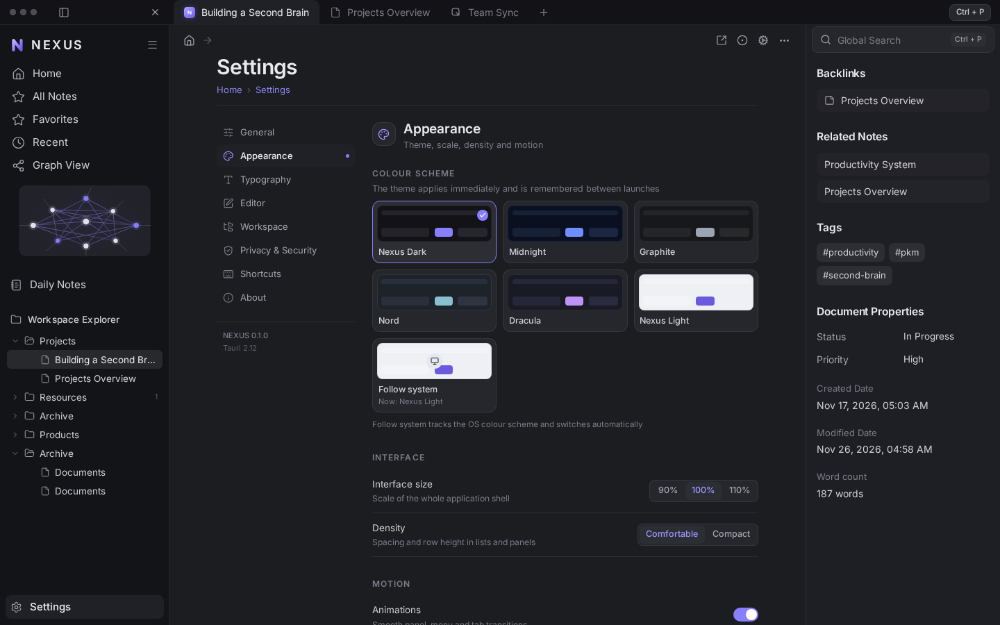
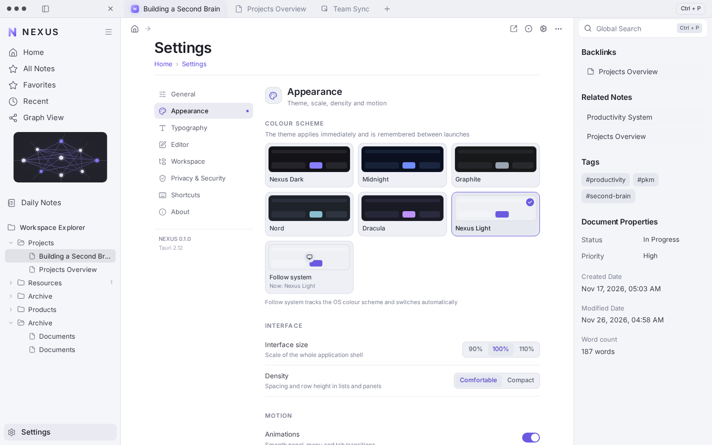
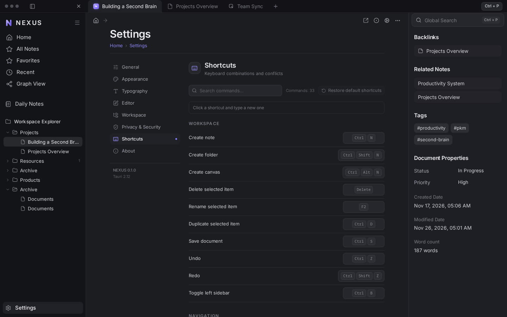

# NEXUS

**Локальное десктоп-приложение для работы со знаниями.** Документы и папки, markdown-редактор,
обратные ссылки и связи, интерактивный Canvas (infinite whiteboard), Command Palette и
полноценные настройки — всё в одном нативном окне. Данные не покидают устройство: нет
аккаунтов, синхронизации, телеметрии и сетевых запросов.

[](https://github.com/<USER>/nexus/releases)
[](https://tauri.app)
[](https://react.dev)
[](https://www.typescriptlang.org)
[](LICENSE)


## Скриншоты

| Основной экран | Command Palette |
| --- | --- |
|  |  |

| Canvas — интерактивная доска | Настройки (6 тем) |
| --- | --- |
|  |  |

| Светлая тема | Управление горячими клавишами |
| --- | --- |
|  |  |

## Возможности

### Рабочее пространство
- Workspace Explorer: вложенные папки и заметки, inline-переименование (F2), мультивыбор
  (Ctrl/Shift), контекстные меню, создание заметок/папок/досок.
- Полноценное удаление: Delete (вне текстовых полей), меню, кнопка, подтверждение с выбором
  «удалить папку с содержимым / перенести содержимое выше», Undo из тоста и Ctrl+Z.
- Вкладки документов: Ctrl+Tab / Ctrl+Shift+Tab, Ctrl+W, восстановление сессии.

### Редактор
- Markdown-live: заголовки, списки, цитаты, код, `[[ссылки]]`, floating toolbar, диалог ссылки.
- Настройки шрифтов, интервалов, переноса строк, номеров строк, подсветки, автосохранения.
- Глобальный поиск, вычисляемые backlinks/related-заметки, теги, статус и приоритет документа.

### Canvas
- Бесконечный холст: pan/zoom (10–400%), fit, reset, сохранение viewport.
- Sticky/Text/Shapes/Connector/Draw/Image/Document-card/Eraser, resize/rotate, цвета, слои,
  выравнивание, группировка, copy/paste, undo/redo (40 шагов), несколько досок.
- Карточки реальных документов (открываются, переживают переименование, корректно реагируют
  на удаление), поиск по объектам, экспорт PNG, контекстное меню, хоткеи.

### Настройки и UX
- 8 разделов: General, Appearance (**6 реальных тем** + системная), Typography, Editor,
  Workspace, Privacy & Security, Shortcuts, About.
- Shortcut Manager: переназначение, проверка конфликтов, сброс.
- RU/EN без перезапуска; сдержанные анимации + reduced motion; тосты, подтверждения, empty states.
- Экспорт/импорт резервной копии (workspace + настройки + Canvas) с валидацией и санитайзом.

## Установка

Подробно — в [docs/INSTALL.md](docs/INSTALL.md).

### Быстро: готовый бинарник

```bash
curl -L -o nexus.tar.gz https://github.com/<USER>/nexus/releases/download/v0.1.0/nexus-0.1.0-linux-x86_64.tar.gz
tar -xzf nexus.tar.gz
chmod +x nexus && ./nexus
```

Требуется Linux x86_64 с WebKitGTK 4.1 и GTK 3.

### Из исходников

```bash
git clone https://github.com/<USER>/nexus.git
cd nexus
pnpm install
pnpm tauri dev                 # разработка
pnpm tauri build --no-bundle   # src-tauri/target/release/nexus
```

Зависимости для Arch/CachyOS:

```bash
sudo pacman -S --needed base-devel rust nodejs pnpm webkit2gtk-4.1 gtk3 libsoup3 librsvg
```

## Стек

**Tauri 2** (Rust + WebKitGTK) · **React 19** · **TypeScript** (strict) · **Tailwind CSS 3.4** ·
**zustand** (+persist) · **Konva / react-konva** · **Lucide** · **Inter Variable**.

## Разработка

```bash
pnpm dev            # фронтенд в браузере
pnpm build          # tsc strict + production build
pnpm tauri dev      # настольное приложение
pnpm tauri build    # релиз + бандлы
```

Структура: `src/lib` — состояние/настройки/темы/i18n/шорткаты/безопасность;
`src/components` — оболочка и UI-примитивы; `src/canvas` — доска; `src/settings` — настройки;
`src-tauri` — нативная обвязка (CSP, capabilities). Подробнее — [README-раздел структуры](#структура).

## Приватность и безопасность

- Нет телеметрии, аналитики и HTTP-запросов; единственное хранилище — localStorage WebView.
- Строгая production CSP, минимальные Tauri capabilities (только оконные контролы),
  devtools и лишние зависимости исключены из релиза, бинарник stripped.
- HTML заметок санитайзится при загрузке/вставке/импорте; внешние ссылки не навигируют WebView.
- Полный аудит: [docs/security-audit.md](docs/security-audit.md).

## Документация

- [Установка и обновление](docs/INSTALL.md)
- [Отчёт об аудите и доработке](docs/AUDIT_REPORT.md)
- [Результаты тестирования](docs/test-results.txt)
- [Аудит безопасности](docs/security-audit.md)

## Известные ограничения

- Хранение в localStorage (квота ~5 МБ): большие Canvas-изображения могут не сохраниться — используйте бэкап.
- Canvas: геометрия rect/ellipse, без реверса стрелок/ручных якорей, snap-to-grid не реализован.
- Номера строк в rich-редакторе приблизительные; стиль курсора зависит от WebKit.
- Производительность на тысячах документов/объектов не профилировалась.

## Лицензия

[MIT](LICENSE) © NEXUS contributors
