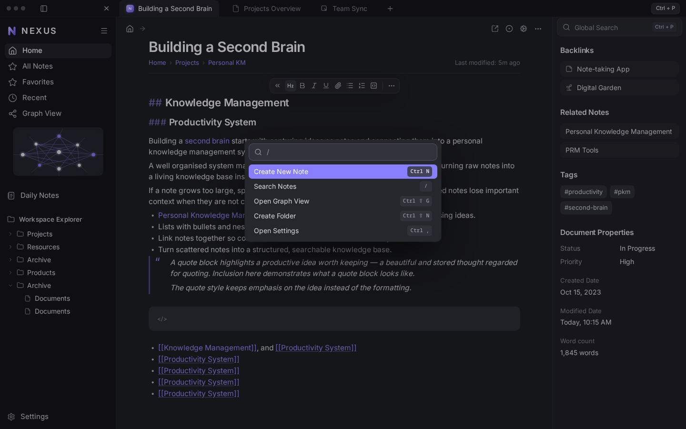

# NEXUS

Десктопное приложение для ведения заметок в стиле «personal knowledge workspace»:
левая панель навигации и workspace-дерева, центральный markdown-редактор,
правый контекст (backlinks / related / tags / properties) и Command Palette.

Сделано по референс-дизайну Gemini и максимально точно воспроизводит его композицию,
отступы, цвета и типографику.



## Стек

- **Tauri 2** (Rust + WebKitGTK, окно без системных декораций — собственный title bar)
- **React 19 + TypeScript**
- **Tailwind CSS 3.4** (дизайн-токены в `tailwind.config.js` + `src/index.css`)
- **Lucide Icons**
- **Inter Variable** (`@fontsource-variable/inter`)

## Быстрый старт

```bash
pnpm install

# разработка (Vite + Tauri, окно 1440×900)
pnpm tauri dev

# релизная сборка (бинарник: src-tauri/target/release/nexus)
pnpm tauri build --no-bundle

# только фронтенд в браузере (для отладки UI)
pnpm dev
```

Требования: Node ≥ 20, Rust (stable), WebKitGTK 4.1, GTK 3.

## Скриншоты

| Что | Файл |
| --- | --- |
| Референс vs реализация (stacked) | `screenshots/00-comparison-reference-vs-build.png` |
| Основной экран 1440×900 | `screenshots/01-default-1440x900.png` |
| Command Palette | `screenshots/02-command-palette-1440x900.png` |
| Graph View | `screenshots/03-graph-view-1440x900.png` |
| Адаптив 1920×1080 / 1366×768 / 1280×720 | `screenshots/04…06` |
| Реальное окно Tauri | `screenshots/07-real-tauri-window-1440x900.png` |
| Свёрнутые панели | `screenshots/08…09` |
| Живое окно: палитра + свёрнутый сайдбар | `screenshots/10-live-window-interactions.png` |

## Структура

```
src/
  App.tsx                  — состояние приложения, роутинг по разделам, хоткеи
  components/
    TitleBar.tsx           — окно-контролы, вкладки, Ctrl+P
    LeftSidebar.tsx        — NEXUS, навигация, graph-карточка, workspace-дерево
    MainPane.tsx           — шапка документа, breadcrumbs, toolbar, контент
    NoteEditor.tsx         — contentEditable markdown-live-редактор
    FormattingToolbar.tsx  — панель форматирования
    RightSidebar.tsx       — поиск, backlinks, related, tags, properties
    CommandPalette.tsx     — палитра команд (Ctrl+P)
    GraphPreview.tsx       — SVG knowledge-graph (карточка и Graph View)
    Views.tsx              — списки заметок, Graph View, настройки
  lib/
    data.ts                — заметки, метаданные, дерево, команды
    window.ts              — minimize / maximize / close (Tauri API)
  index.css                — дизайн-токены, стили редактора, скроллбары
src-tauri/                 — Tauri 2: окно без декораций, 1440×900, иконки
```

## Интерактивность

- вкладки документов: переключение, «+» — новая заметка;
- Command Palette: `Ctrl+P` / `Ctrl+K`-стиль, поиск, `↑↓`, `Enter`, `Esc`, клик по фону;
- левая навигация: Home, All Notes, Favorites, Recent, Graph View, Daily Notes;
- workspace-дерево: раскрытие/сворачивание папок, открытие заметок;
- правый сайдбар: глобальный поиск с выпадающими результатами, backlinks/related/tags,
  свойства документа;
- Graph View: клик по узлу открывает заметку;
- сворачивание обеих панелей (кнопки в title bar + фокус-режим);
- форматирование: заголовок, bold/italic/underline, ссылка, списки, код, очистка;
- горячие клавиши: `Ctrl+P`, `Ctrl+N`, `Ctrl+Shift+N`, `Ctrl+Shift+G`, `Ctrl+,`, `Ctrl+F`, `Esc`;
- окно: перетаскивание за title bar, minimize / maximize / close реализованы через Tauri API.

## Дизайн-заметки

- Метрики сняты с референса и пересчитаны на 1440 px: сайдбары **244 / 280 px**,
  title bar **36 px**, контент-колонка с отступами **68 px**, ширина колонки редактора ≈ 780 px.
- Палитра: фон `#121217`, левая панель `#131418`, рабочая область `#1c1d21`,
  правая панель `#1e1e25`, акцент `#877ffe`, карточки `#232329`, код `#2b2b34`.
- Шрифт — Inter Variable; в референсе, судя по метрикам, использован SF Pro,
  поэтому отдельные строки могут быть на 3–7 % шире/уже при совпадающей высоте.
- Референс — макет окна с соотношением ~1.85; приложение работает в окне 16:10
  (1440×900), поэтому по вертикали помещается больше контента. Это единственное
  осознанное отклонение от картинки.

## Проверено

- `pnpm build` — сборка без ошибок TypeScript;
- Playwright-прогон: 23/23 проверок (вкладки, палитра, навигация, дерево, сворачивание
  панелей, поиск, настройки, форматирование, отсутствие ошибок в консоли);
- адаптив: 1920×1080, 1440×900, 1366×768, 1280×720 — без горизонтального скролла,
  панели сохраняют ширину;
- реальное окно Tauri 2 запущено и снято (`screenshots/07…`);
- релизная сборка: `src-tauri/target/release/nexus`.
