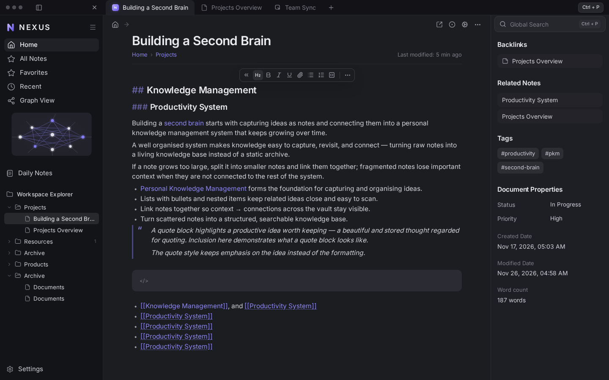

# NEXUS

Локальное десктопное приложение для работы со знаниями: дерево документов,
markdown-редактор, обратные ссылки/связи, **интерактивный Canvas (infinite whiteboard)**,
полноценные настройки (6 тем, типографика, хоткеи, приватность), Command Palette.

Построено на **Tauri 2 + React 19 + TypeScript + Tailwind CSS + Lucide**, состояние —
`zustand` с персистентностью в localStorage WebView. Сетевых запросов и телеметрии нет:
все данные остаются на устройстве.



## Что умеет

### Рабочее пространство
- Workspace Explorer: единое дерево заметок/папок, вложенность, inline-переименование (F2),
  мультивыбор (Ctrl/Shift), контекстное меню, создание заметок/папок/канвасов.
- **Удаление**: клавиша Delete (только вне текстовых полей), контекстное меню,
  кнопка в шапке Explorer, подтверждение с выбором «удалить папку с содержимым» или
  «перенести содержимое выше», настройка «больше не спрашивать», Undo из тоста и
  Ctrl+Z/Ctrl+Shift+Z (глобально, вне редактора). Удалённые элементы сразу исчезают из
  поиска, списков, backlinks и Canvas-карточек.
- Вкладки документов: создание, переключение (Ctrl+Tab / Ctrl+Shift+Tab), закрытие (Ctrl+W),
  анимация появления, состояние переживает перезапуск.

### Редактор
- Markdown-live редактор на contentEditable: заголовки, списки, цитаты, код, `[[ссылки]]`,
  панель форматирования, вставка ссылок через диалог.
- Настройки: размер/интервал, перенос строк, «номера строк», подсветка разметки,
  стиль курсора, размер табуляции, автосохранение и его интервал.
- Глобальный поиск с подсветкой результатов, backlinks и related-заметки вычисляются
  из реального содержимого и тегов.

### Canvas — интерактивная доска
- Бесконечный холст: pan (пробел/hand), zoom (Ctrl+wheel, кнопки, 10–400%), fit-to-content,
  reset zoom; viewport сохраняется.
- Инструменты: Select, Hand, Sticky, Text, Shapes (rect/ellipse), Connector, Free draw,
  Image, Document card, Eraser.
- Редактирование: выделение (клик/shift/marquee), move, resize/rotate, цвета, текст,
  шрифт, толщина, прозрачность, duplicate/delete, copy/paste, z-order, выравнивание,
  группировка.
- Соединения привязаны к объектам и не рвутся при перемещении; удаляются отдельно.
- Несколько канвасов: создание, переименование, удаление, переключение; всё автосохраняется
  (`nexus:canvas:v1`), undo/redo на канвас.
- Карточки документов ссылаются на реальные заметки и открывают их; удалённые документы
  помечаются «Document deleted».
- Canvas-шорткаты (V/H/S/T/R/C/D/I/O/E, Delete, Ctrl+Z/Shift+Z, Ctrl+D, Ctrl+C/V/A, Escape),
  поиск по объектам, экспорт PNG, контекстное меню.

### Настройки (8 разделов)
- **General**: язык (RU/EN, мгновенно), автосохранение + интервал, поведение при запуске,
  подтверждения удаления, уведомления и их длительность, сброс.
- **Appearance**: 6 реальных тем (Nexus Dark, Nexus Light, Midnight, Graphite, Nord, Dracula)
  + «как в системе», масштаб интерфейса 90/100/110%, плотность, анимации,
  режим движения (system/full/reduced) с поддержкой `prefers-reduced-motion`.
- **Typography**: шрифты UI/редактора/моно, размеры, интервал, толщина + fallback-проверка.
- **Editor**, **Workspace**: параметры редактора и Explorer’а (сортировки, hidden, reveal active).
- **Privacy & Security**: локальное хранилище и его размер, отсутствие телеметрии/сети,
  диагностика (только в памяти), экспорт/импорт бэкапа с валидацией и санитайзом,
  очистка временных данных, реальный список разрешений.
- **Shortcuts**: поиск, группы, запись новых сочетаний, проверка конфликтов, сброс
  одной команды/всех, восстановление по умолчанию.
- **About**: версии (NEXUS 0.1.0, Tauri 2.12.7), стек, лицензии, копирование сведений.

### UX
- Command Palette (Ctrl+P): команды, поиск, клавиатурная навигация.
- Качественные, но сдержанные анимации: панели, модалки, меню, вкладки, дерево, тосты,
  смена темы; всё отключается через reduced motion.
- Toast-уведомления с действиями (Undo), подтверждения, контекстные меню, empty states,
  стилизованные скроллбары, адаптив 1920×1080 / 1440×900 / 1366×768 / 1280×720.
- Error Boundary: ошибка UI не оставляет белый экран.

## Быстрый старт

```bash
pnpm install

pnpm tauri dev                 # разработка (Vite + Tauri, окно 1440×900)
pnpm tauri build --no-bundle   # релизный бинарник: src-tauri/target/release/nexus

pnpm dev                       # только фронтенд в браузере
pnpm build                     # type-check + production build
```

Требования: Node ≥ 20, Rust (stable), WebKitGTK 4.1, GTK 3.

## Структура

```
src/
  App.tsx                 — каркас окна, темы, диагностика, guard внешних ссылок
  main.tsx                — применение настроек до первого paint
  components/             — titlebar, sidebar'ы, редактор, палитра, диалоги, ui-примитивы
  canvas/                 — Canvas: store, Konva-сцена, инструменты, свойства, поиск
  settings/               — 8 разделов настроек, виджеты, бэкапы
  lib/                    — store (zustand+persist), settings, theme, i18n, shortcuts,
                            sanitize, format, commands, window (Tauri API)
  index.css               — 6 тем (CSS-переменные), анимации, редактор, density
src-tauri/                — Tauri 2: окно без декораций, минимальные capabilities, CSP
docs/                     — отчёт аудита, security-отчёт
screenshots/              — UI-скриншоты (audit/ — результат аудита)
```

## Безопасность и приватность

- Нет телеметрии, аналитики, трекеров и HTTP-запросов — проверено аудитом кода и
  ресурсными записями браузера; единственное хранилище — localStorage WebView.
- Tauri: CSP для production + отдельный devCsp, минимальные capabilities
  (только window-контролы), devtools отключены в релизе, release-бинарник stripped.
- HTML заметок санитайзится при загрузке, вставке/дропе и импорте бэкапа;
  внешние ссылки не навигируют WebView; persisted-state валидируется с fallback при порче.
- Полный отчёт: [docs/security-audit.md](docs/security-audit.md),
  итоги аудита: [docs/AUDIT_REPORT.md](docs/AUDIT_REPORT.md).

## Ограничения

- Хранение только в localStorage: большие вложения Canvas (изображения) могут исчерпать
  квоту — используйте бэкап (настройки → Privacy) и следите за размером.
- Номера строк в редакторе приблизительные (по визуальным строкам/блокам), стиль курсора
  зависит от поддержки CSS `caret-shape` в WebKitGTK.
- Реальный клик по window-кнопкам (minimize/maximize/close) не покрыт e2e (нет инструмента
  инъекции ввода в niri); вызовы Tauri API и permissions проверены сборкой.
- Производительность при тысячах документов/объектов не измерялась (текущие сценарии — сотни).
